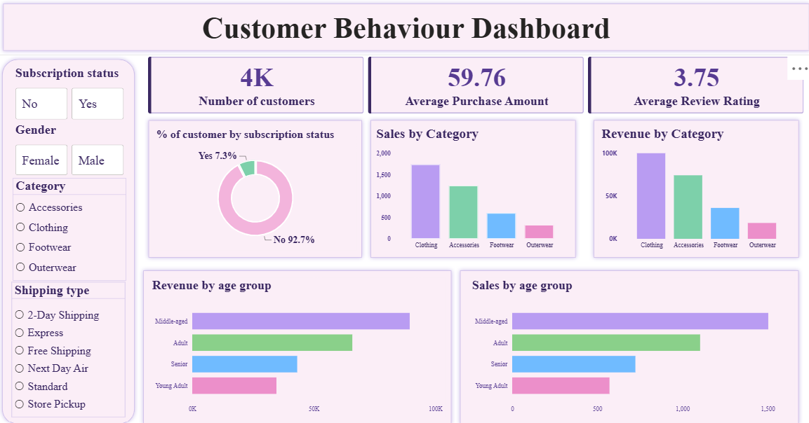

# 🛍️ Customer Shopping Behavior Analysis

### 📊 End-to-End Data Analytics Project | Python • MySQL • Power BI

## 📌 Overview

This project explores customer shopping behavior to understand purchasing patterns, product preferences, subscription trends, and discount usage.

The project follows an end-to-end data analytics workflow, from loading and cleaning raw data in Python to analyzing business questions using MySQL and building an interactive Power BI dashboard.

**🎯 Project Objectives**
- Analyze customer purchasing behavior and product preferences.
- Explore revenue and sales patterns across product categories.
- Examine subscription status and discount usage.
- Compare purchasing trends across customer age groups.
- Present insights through SQL queries, visualizations, and an interactive dashboard.

## 📂 Dataset

The project uses a customer shopping behavior dataset containing approximately **3,900 customer records**.

Key attributes include:

| Category | Example fields |
|---|---|
| Customer Information | Customer ID, age, gender, location |
| Purchase Details | Item purchased, category, purchase amount |
| Customer Preferences | Size, color, season, payment method |
| Shopping Behavior | Subscription status, discount usage, purchase frequency |
| Customer Feedback | Review rating |

## 🧰 Tools & Technologies

- 🐍 **Python** — Data loading, exploration, and cleaning
- 🧹 **Pandas** — Data manipulation and preprocessing
- 🗄️ **MySQL** — SQL queries and business analysis
- 📊 **Power BI** — Interactive dashboards and KPI visualization
- 📓 **Jupyter Notebook** — Python analysis and documentation
- 🤖 **Claude AI** — Assistance with presentation structure and content
- 🐙 **GitHub** — Project hosting and version control

## 🔄 Project Workflow

### 1. 🐍 Data Loading & Exploration

- Imported the dataset into Python using Pandas.
- Examined the dataset structure, column names, and data types.
- Reviewed summary statistics and checked for missing values and duplicate records.
- Explored customer demographics and purchasing variables.

### 2. 🧹 Data Cleaning & Preprocessing

- Investigated missing and inconsistent values.
- Checked for duplicate records and handled them where appropriate.
- Standardized data formats and corrected data types where necessary.
- Created an `age_group` column to support demographic comparisons.
- Prepared the dataset for further analysis.

### 3. 🗄️ SQL Analysis Using MySQL

- Loaded the dataset into a MySQL database.
- Wrote SQL queries to answer business-related questions.
- Used filtering, grouping, aggregation, sorting, and subqueries where appropriate.
- Analyzed purchase amounts, product ratings, discount usage, and customer behavior.

### 4. 📊 Power BI Dashboard

Developed an interactive dashboard to summarize customer shopping behavior.

**Dashboard highlights:**
- 👥 Number of Customers
- 💰 Average Purchase Amount
- ⭐ Average Review Rating
- 🥧 Customer Distribution by Subscription Status
- 📊 Revenue by Product Category
- 🛒 Sales by Product Category
- 👤 Revenue and Sales by Age Group
- 🎛️ Interactive slicers for customer and purchase attributes

### 5. 📝 Report & Presentation

- Used Claude AI to assist with organizing the PowerPoint presentation.
- Reviewed the final content for clarity and consistency with the analysis.

## 📊 Dashboard Preview



## 💡 Results & Key Insights

The analysis examines the following business questions:

**1. Which product categories generate the highest revenue and sales?**
Clothing is the top category on both measures, with about 1,700 sales and $100K in revenue (around 44% of the total). Accessories ranks second (about 1,200 sales, $75K), followed by Footwear and Outerwear, which together contribute less than a quarter of revenue.

**2. How are customers distributed by subscription status?**
7.3 % of customers are subscribers and 92.7% are not. 

**3. How do purchasing patterns differ across age groups?**
Middle-aged customers generate the highest revenue. Middle-aged customers also have the highest sales. Young adults contribute the least among the four age groups shown.

**4. Which products receive higher average review ratings?**
ratings are very similar across categories with Footwear slightly ahead with average rating (3.81/5), while Clothing has the lowest (3.72/5).


## 📁 Project Structure

```text
Customer_Behaviour_analysis/
│
├── Customer_Behaviour_ppt.pptx
├── README.md
├── customer_behavior_sql_queries.sql
├── customer_behaviour_analysis.ipynb
├── customer_dashboard.pbix
├── customer_shopping_behavior.csv
└── dashboard.png
```

## ⚙️ How to Run

1. **Clone or download the repository:** Download the project files to your computer.
2. **Set up Python:** Install the required libraries:
   ```bash
   pip install pandas numpy sqlalchemy pymysql
   ```
3. **Load the dataset:** Use `customer_shopping_behavior.csv` in the Jupyter Notebook.
4. **Run Python analysis:** Open `customer_behaviour_analysis.ipynb` in Jupyter Notebook and execute the cells to perform data cleaning and analysis.
5. **Set up MySQL:** Open MySQL Workbench, create the required database, and configure the MySQL connection in the Python notebook.
6. **Run SQL queries:** Open `customer_behavior_sql_queries.sql` in MySQL Workbench and execute the queries to analyze customer shopping behavior.
7. **View the dashboard:** Open `customer_dashboard.pbix` in Power BI Desktop to explore the interactive dashboard.
8. **View the presentation:** Open `Customer_Behaviour_ppt.pptx` to see the project presentation.


## 🚀 Conclusion

This project demonstrates practical experience with an end-to-end data analytics workflow, including data exploration, data cleaning, SQL querying, interactive dashboard development, and communicating insights through reports and presentations.

It showcases the use of Python, MySQL, and Power BI to transform customer shopping data into meaningful, business-oriented insights.

## 👩‍💻 Author

**Ritika Pote**

- LinkedIn: [linkedin.com/in/ritikapote](https://www.linkedin.com/in/ritikapote)

---

⭐ *If you find this project useful, feel free to explore the repository and its analysis.*
